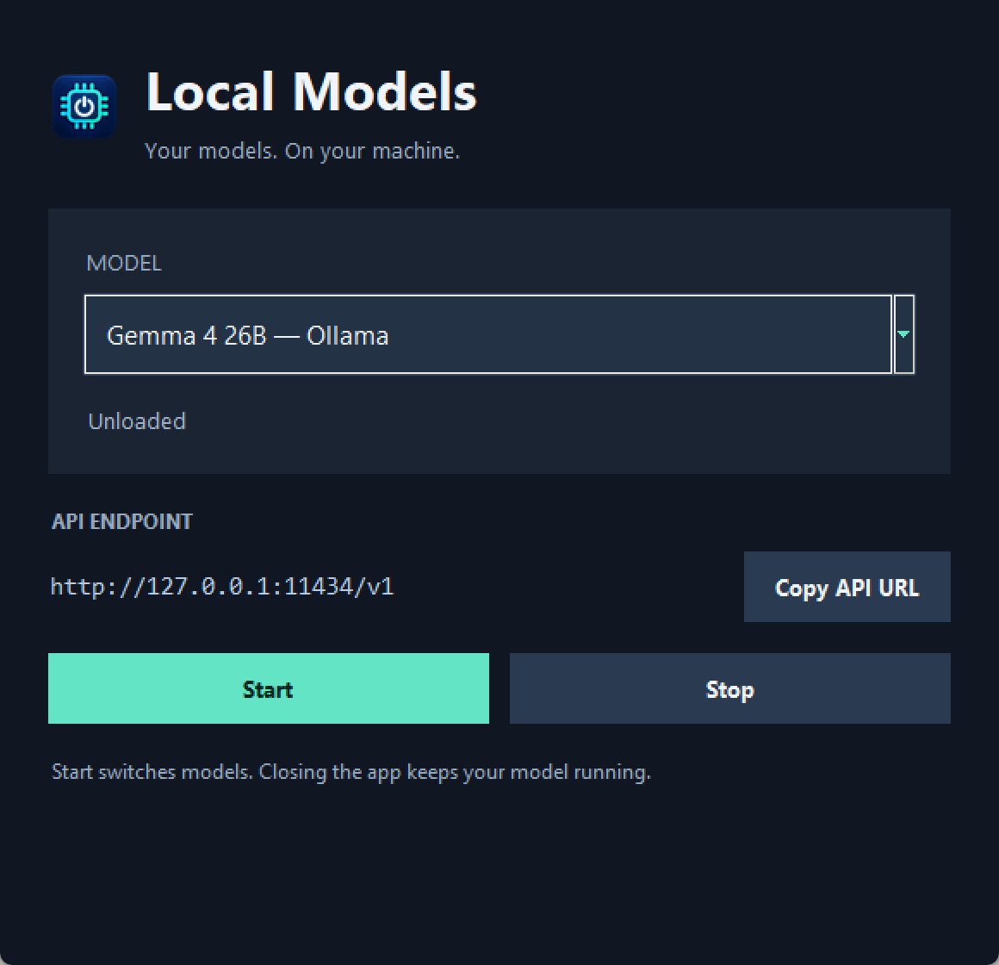
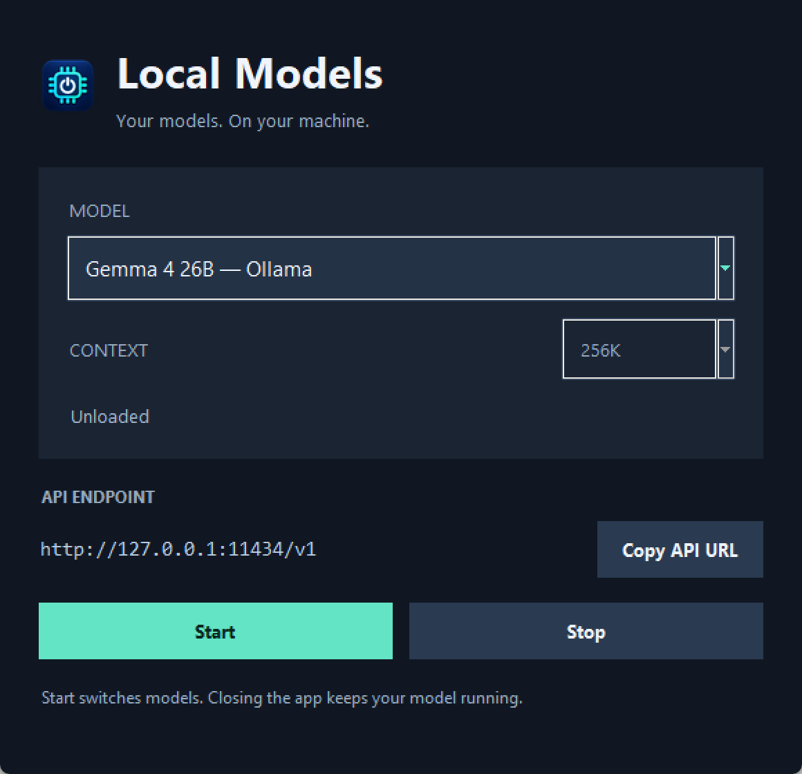
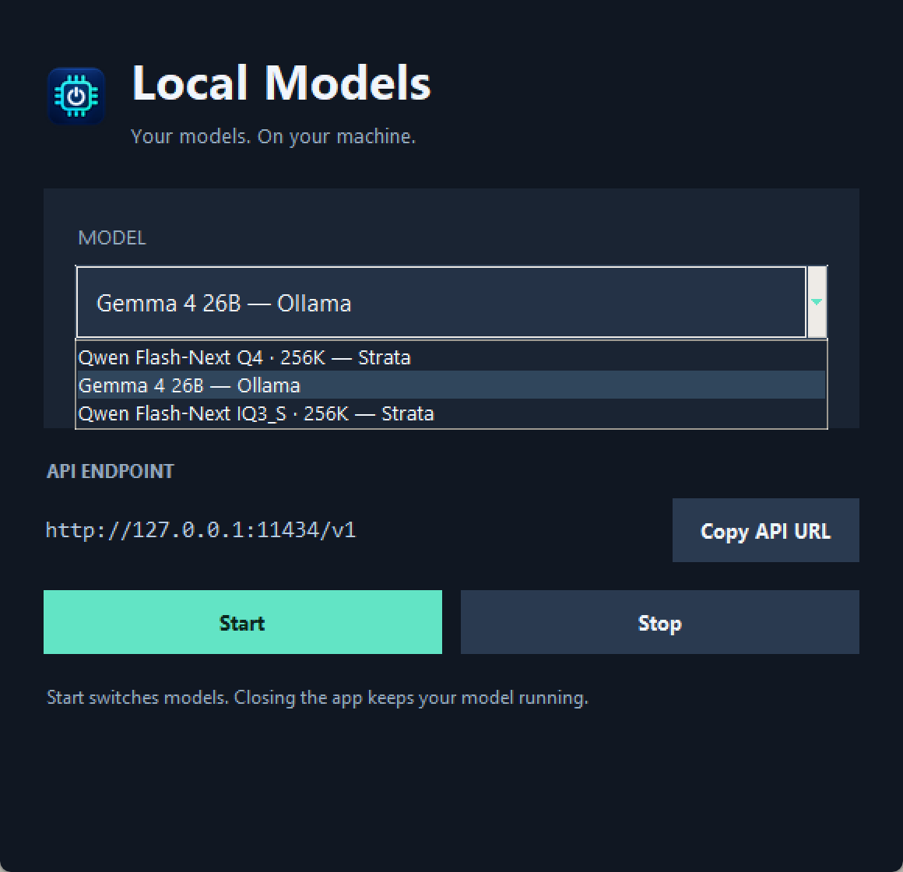
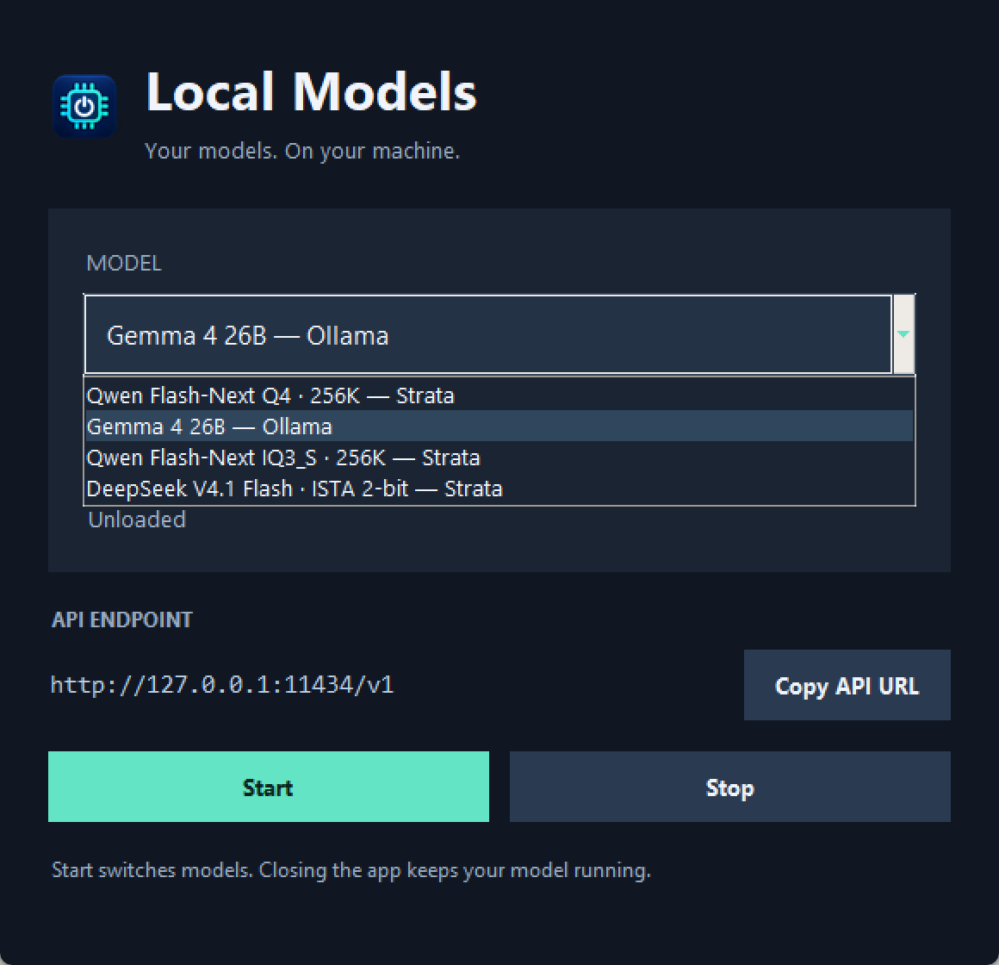
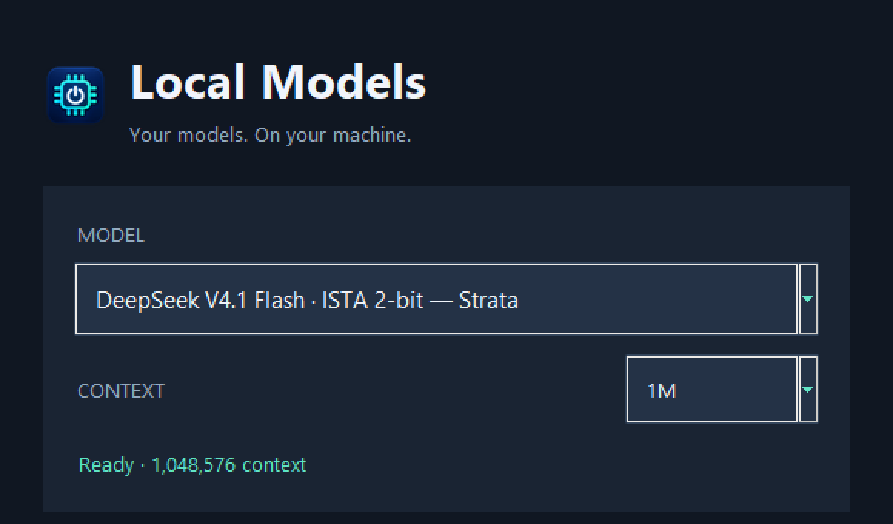
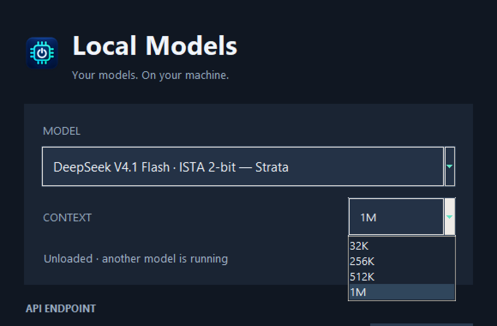

# Maxis: installed Qwen, DeepSeek 2.00 bpw and Avalon

These are task-specific speed and context-capacity measurements from 2 November 2026. They are **not** the Strata standard benchmark protocol, a model-quality ranking, or an optimized Avalon speed claim.

## Medium input

“Medium” means approximately 32,768 input tokens here. Each row is the median of three fresh, serial requests for 512 output tokens. The context limit was 262,144 for all rows.

| Runtime and model | Actual input tokens | Prompt processing | Prompt tokens/s | Generation, 512 tokens | Generated tokens/s | Client first token |
| --- | ---: | ---: | ---: | ---: | ---: | ---: |
| Installed Strata 0.1.40.3, Qwen3.8 Flash Next UD-Q4_K_XL | 32,728 | 22.976 s | 1,424.5 | 10.835 s | 47.3 | 23.330 s |
| Installed Strata 0.1.40.3, Qwen3.8 Flash Next GSQ-RCO IQ3_S | 32,728 | 12.379 s | 2,643.8 | 6.066 s | 84.4 | 15.562 s |
| Strata DeepSeek engine 0.1.55, IST-DAS 2.00 bpw | 32,742 | 48.838 s | 670.4 | 52.686 s | 9.7 | 48.922 s |
| Avalon a91372e, installed Qwen IQ3_S, cache off / no MTP | 32,768 | 23.186 s | 1,413.2 | 25.004 s | 20.4 | 23.577 s |

Medians are calculated independently for each column. Raw measurements and generated answers are in [data](data). All measured runs report zero cached prompt tokens and 512 generated tokens. The first run is retained, including cold-cache/graph effects; no fastest-run selection was made.

Engine prompt/generation timings exclude some API, scheduling and checkpoint work. The separately measured client first-token and wall times include that overhead. Do not add two median columns to predict an individual request's latency. Qwen and DeepSeek have different tokenizers and model architectures; these are the installed configurations, not a controlled engine-only A/B.

## DeepSeek context capacity

The requested windows are 256K = 262,144, 512K = 524,288 and 1M = 1,048,576 positions. Each test reserves 512 positions for output. The count endpoint and inference template differ by 26 input tokens in these runs; report inference usage rather than the requested target.

| Configured window | Actual input | Prompt processing | Prompt tokens/s | Generated tokens/s | Client first token | Request wall time | Audit codes |
| --- | ---: | ---: | ---: | ---: | ---: | ---: | --- |
| 256K | 261,606 | 360.265 s (6m 00s) | 726.1 | 7.9 | 360.743 s | 425.246 s | 3/3 |
| 512K | 523,750 | 745.571 s (12m 26s) | 702.5 | 8.4 | 746.466 s | 807.323 s | 3/3 |
| 1M | 1,048,038 | 1,706.206 s (28m 26s) | 614.3 | 8.0 | 1,707.935 s | 1,771.602 s | 3/3 |

Each long case completed one fresh, uncached request and generated all 512 output tokens. The 1M case used 1,048,550 total positions including output, below the configured 1,048,576 ceiling. All three windows loaded and processed the input without an allocation error. The engine was stopped after each case; no benchmark was left running.

The machine reaches the model's full advertised window, but the speed is costly: almost half an hour before the first token for the near-full 1M prompt. Qwen IQ3_S is the desktop default for speed. DeepSeek remains an optional installed model with 32K, 256K, 512K and 1M choices. No further DeepSeek tuning or quantization downloads were attempted after these results.

The retrieval task places three synthetic, random 12-character audit codes at the beginning, middle and end of the archive. A pass means all three occur in the generated answer. A full input that generates output establishes runtime capacity; this small needle task does not establish reliable retrieval for arbitrary documents, reasoning, coding or production agents. Each context uses a different archive and codes, with no cross-window prompt reuse.

## Hardware and configuration

- Windows 11 Pro, 10.0.26300 build 26300.
- AMD Ryzen 9 9950X3D, 16 cores / 32 threads; 128 GiB installed DDR5, configured 5600 MT/s.
- NVIDIA RTX 3090, 24 GiB; driver 610.88. One inference engine active at a time.
- Model files on the 2 TB Crucial CT2000P310SSD8 NVMe. Disposable builds, packs and logs on a 4 TB HGST SATA HDD. A background DeepSeek download used the HDD during initial Qwen measurements; no Avalon compilation ran during those requests.
- Qwen uses the existing installed engine and profiles, not an upgrade to the current Qwen engine. Both use INT8 KV, a 262,144-position ceiling, 32,768 resident KV positions, expert-cache/prefill auto and speculative depth 4 with the existing Q4 MTP pack. Q4 reserves 3072 MiB VRAM and a 64 GiB resident budget; IQ3_S reserves 4096 MiB and keeps its existing conversation cache/parallel settings. Requests are serial. Sanitized complete profiles are in [configuration](configuration).
- DeepSeek uses source base 46c152a1 with the signed release engine 0.1.55 (build source 99866a47a2b8, CUDA 13.0). It uses setup defaults except the requested window and API port: vision off, DSpark auto, prefill chunks of 8192. On this 24 GiB card the engine explicitly declines DSpark because verification would read more expert bytes. The 8 GB drafter is installed but is not active.
- DeepSeek is the Strata-recommended **IST-DAS 2.00 bpw set**, named IQ2_XXS in the shard filenames. It is a mixed-precision set, not every tensor at exactly two bits. Only this DeepSeek variant was downloaded. Total model/shared files are about 257 GB: 138.24 GB main shards, 110.60 GB Engram, 7.98 GB DSpark, and a small metadata shard. Download SHA-256 checks passed before packing.
- The original Qwen engine build is 0.1.40.3, source checkout d5ea7133 with existing local customizations. The current source base and the older installed engine are deliberately recorded separately. Existing Qwen weight files were reused, not re-downloaded or rehashed during inference.

[Provenance](provenance.json) records exact DeepSeek file sizes and verified hashes, engine build manifests, the Avalon revision and the original launcher's SHA-256. The main/Engram repository is [ISTA-DASLab](https://huggingface.co/ISTA-DASLab/DeepSeek-V4.1-Flash-1017-GSQ-RCO-GGUF/tree/cb02422c900df489cea5833e8a92171224059b3c). Auxiliary metadata/DSpark files use [Unsloth revision f924b94](https://huggingface.co/unsloth/DeepSeek-V4.1-Flash-1017-GGUF/tree/f924b94f19c1fea02c06a65c8475b0a45e2b88b1).

## Avalon findings

[Avalon](https://github.com/freriadoc/Avalon/tree/a91372eb6442da68dabb6495b8440ed96ab5910c) is a separate llama.cpp fork, not a new Strata release. The checked revision was built and executed natively on Windows with MSVC 19.44.35229, CUDA compiler 13.0.88, C++17 and sm_86. [avalon-msvc.patch](avalon-msvc.patch) contains the native Windows compatibility changes; its SHA-256 is recorded in the run profiles. [Build command](logs/build-avalon.cmd) and [successful build log](logs/avalon-build-msvc10.log) are retained. This patch was applied only to the Avalon build, not to Strata's engine.

The intended optimized path, using hosted MoE cache and the recommended shared MTP draft, aborted during warmup with the installed IQ3_S main weights:

```text
ggml_cuda_graph_evaluate_and_capture: MUL_MAT_ID with host weights outside a hosted MoE block (ffn_moe_gate-1)
```

Cache-on without MTP and cache-auto without MTP also aborted with that error. [Failure logs](logs/avalon-server.err.log) and their configurations are retained. This demonstrates a failure for this Windows build/model combination, not that the intended Avalon model sets fail generally. A dedicated Avalon main quantization was not downloaded.

The only successful mode was **MoE cache off, speculative type none**. It reused the exact installed IQ3_S target shards, with context 262,144, batch/ubatch 8192, flash attention on, q8_0 K/V and one slot. It answered the smoke question and completed all three 32K requests. Its numbers above are a fallback comparison and do not test Avalon's advertised optimization. The recommended 1.48 GB [shared draft](https://huggingface.co/freriadoc/Qwen3.8-Flash-Next-Avalon-GGUF/tree/372fe3a4e572c5ba75a90e579de0695633d083a8) was SHA-256 verified but was used only in the failed optimized-mode startup.

## Reproduction and evidence

Use [tools/local-model-benchmark.py](../../../tools/local-model-benchmark.py) against the installed API. It calibrates the synthetic archive through that model's tokenizer, streams a fresh request, and saves usage, answer, engine timings, client timing, seed and prompt hash. Thinking is disabled, temperature is zero and the output cap is 512. No tool calls, image input, concurrency or broad answer-quality suite was tested.

```powershell
python tools/local-model-benchmark.py --url http://127.0.0.1:8086 --label deepseek-2bit-262144 --prompt 32768 --output 512 --runs 3 --seed-base maxis-20261102 --out build-local/results
python tools/local-model-benchmark.py --url http://127.0.0.1:8086 --label deepseek-2bit-262144 --prompt 261632 --output 512 --runs 1 --seed-base maxis-20261102 --retrieval --timeout 14400 --out build-local/results
```

Load the matching 524,288 or 1,048,576 profile before testing 523,776 or 1,048,064 input targets. For Avalon, use `--kind avalon` and its configured port. Exact later request payloads are gzip-compressed in [requests](requests), with seeds and hashes in each result. The first Avalon run used the earlier seed format; its payload is retained. The six initial Qwen results retain their prompt hashes and outputs, but the initial harness did **not** save the random seeds or exact inputs, so those historical prompts cannot be reconstructed byte for byte. They still provide observed timing evidence.

Machine paths and private LAN addresses in logs/configurations are replaced with placeholders. Model files, Python environments, credentials and machine registry are not committed. [SHA256SUMS](SHA256SUMS) covers retained evidence files.

## Desktop verification

The optional [Local Models launcher](../../../tools/LOCAL_MODELS.md) now supports the installed Qwen Q4, Qwen IQ3_S, Gemma/Ollama and DeepSeek profiles. Opening the window does not load a model. Starting a model uses its configured interpreter/source and context, and stops only a server whose PID, creation time and configuration match the launcher's ownership state. An unknown API listener is preserved.

Five lifecycle regression tests passed on Maxis, including recycled PID, foreign command, occupied API, cross-backend isolation and unsupported context. Real Qwen Q4, Qwen IQ3_S and Gemma requests returned Paris, and their saved API checks are in [launcher](launcher). The DeepSeek profile also passed a real LAN chat request with the 1,048,576-position window loaded. The desktop shortcut now points to this launcher; the original shortcut is backed up locally. Qwen IQ3_S is selected and running at 262,144 context. DeepSeek is unloaded.

Before/after captures show the actual installed launcher and final launcher at the same 580×560 logical viewport and 200% Windows scaling. The baseline is the user's existing untracked customization at source checkout d5ea7133, identified by SHA-256 in provenance; there was no committed launcher at the upstream base. The captured model-selection state uses Gemma, keeping private LAN addresses out of the screenshots.

| Changed state | Before | After |
| --- | --- | --- |
| Main window |  |  |
| Model choices |  |  |
| DeepSeek ready at 1M | No prior equivalent |  |
| DeepSeek context choices | No prior equivalent |  |

The native Tauri app, other GPU backends and other operating systems were not built or tested: their source/build graph was not changed. The Avalon patch was built and run only on Windows CUDA. No optimized Avalon speed result is claimed. No broad DeepSeek quality comparison or hardware-upgrade claim is made.
